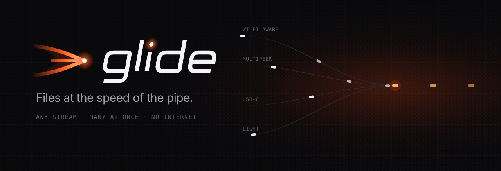
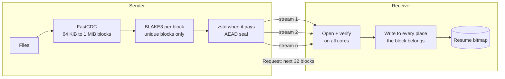

<p align="center">
  
</p>

<p align="center">
  <a href="https://github.com/GuusLab/Glide/actions/workflows/ci.yml"></a>
  
  
  
</p>

<h3 align="center">Hand it any connection. It moves your files over all of them at once.</h3>

<p align="center">
Encrypted. Verified block by block. Resumes where it stopped.<br>
Sends only what the other side does not already have.<br>
No server, no account, no internet.
</p>

<br>

```console
$ glide send ./shoot-2026 --listen 0.0.0.0:7001,0.0.0.0:7002 --key 482913
ready: 1,204 files, 38.6 GB, indexed in 21s

$ glide recv --connect 10.0.0.2:7001,10.0.0.2:7002 --key 482913 --out ./inbox
  100.0%   38.6 / 38.6 GB
  received   2,141 MB   (the rest was already on this laptop)
  stream 0   1,488 MB
  stream 1     653 MB
```

<br>

## The idea

Every file transfer tool picks one pipe and hopes it stays up. AirDrop only speaks AWDL. Quick Share wants Wi-Fi Direct. WebRTC needs a signalling server. If the pipe hiccups, you start over.

**Glide does not care what the pipe is.** It runs on top of any reliable byte stream: TCP, Wi-Fi Aware, Multipeer, Wi-Fi Direct, USB, WebRTC, even light from a screen to a camera. Give it two and it uses both. Pull one out mid-transfer and the other finishes the job.

Everything above the pipe is Glide: the handshake, the encryption, the chunking, the scheduling, the verification, the resume. One small, fast core that behaves identically on a phone, a laptop and in a browser.

<br>

## Numbers

Measured with [`scripts/bench.sh`](scripts/bench.sh) on a **2 vCPU cloud VM**, sender and receiver as separate processes over loopback, both sharing the same two cores. On a laptop or phone with more cores, every number here goes up. Full method and raw output in [`docs/BENCHMARKS.md`](docs/BENCHMARKS.md).

| What | Result |
| --- | --- |
| **Core, per CPU core** (AES-256-GCM + BLAKE3) | **1.09 GB/s** sending, **0.92 GB/s** receiving |
| Core, all cores of this VM | 1.99 GB/s sending, 1.70 GB/s receiving |
| One stream, 1 GB of random data | 431 to 619 MB/s, byte-identical |
| Two streams shaped to 60 + 25 MB/s | **82.6 MB/s** combined, 97% of the ideal 85 |
| Same, one stream killed at 150 MB | finished on the other stream, byte-identical |
| 1 GB file, receiver has the old version, 1 MB inserted at the start | **14 MB** crossed the wire (1.4%) |
| Folder with the same 100 MB clip three times | 100 MB crossed the wire, 200 MB deduplicated |
| Core in the browser (WebAssembly, ChaCha20) | 136 MB/s per core, 49 KB, zero imports |

The point of these numbers: **the protocol is never the bottleneck.** A single core outruns Wi-Fi 6. The pipe decides how fast you go, and Glide makes sure you get all of it.

<br>

## What makes it different

<table>
<tr>
<td width="50%" valign="top">

**Any pipe**<br>
Glide speaks to `AsyncRead + AsyncWrite`. If you can get a byte stream between two devices, Glide can use it.

**Many pipes, at once**<br>
The receiver pulls blocks over every stream. A fast stream simply asks more often. No tuning, no bandwidth probing.

**Never starts over**<br>
A bitmap on disk remembers every verified block. Run it again and it fetches only what is missing, even after a crash.

</td>
<td width="50%" valign="top">

**Sends less**<br>
Content-defined chunking plus BLAKE3 addressing. Edit a 1 GB video and only the edit travels. Copies inside a folder cross once.

**Never wrong**<br>
Every block is authenticated (AEAD) and checked against its BLAKE3 hash before it touches disk. A flipped bit is refused, then fetched again.

**Offline by design**<br>
The key comes from something both people can see: a code on a screen, or a six-digit PIN. No accounts, no certificates, no DNS.

</td>
</tr>
</table>

<br>

## How it works



1. **Handshake.** Noise `NNpsk0` per stream. The pre-shared key is derived from the code or PIN, so a wrong key fails before a single byte of data moves.
2. **Manifest.** The sender cuts every file with FastCDC and hashes each block with BLAKE3. Identical blocks get one ID. The manifest lists files, block positions and hashes.
3. **Reuse.** The receiver looks for those blocks in what it already has: an older version of the file, or any folder you point it at. Matches are copied locally.
4. **Pull.** Each stream keeps 32 blocks in flight. Blocks are sealed with AES-256-GCM when both sides have hardware AES, ChaCha20-Poly1305 otherwise.
5. **Endgame.** When the pool runs dry, idle streams duplicate the last blocks still in flight elsewhere, so the end never waits on the slowest pipe.

The full wire format is in [`docs/PROTOCOL.md`](docs/PROTOCOL.md). It fits on a few pages on purpose.

<br>

## Use it in your app

```rust
use glide::{Key, Sender, Options};

let key = Key::from_secret("482913"); // the code on screen, or a PIN

// sender: index once, serve any number of streams
let sender = Sender::new("holiday-photos/")?;
let k = key.clone();
tokio::spawn(async move { sender.serve(stream_a, &k).await });

// receiver: as many streams as you have, of any kind
let report = glide::receive(vec![stream_b, stream_c], &key, "inbox/", Options::default()).await?;
println!("{:.0} MB/s, {} MB reused", report.mb_per_sec(), report.reused / 1_000_000);
```

That is the whole API. Bring your own streams: a `TcpStream`, a Wi-Fi Aware socket from Apple's Network framework or Android, a Multipeer stream, a WebRTC data channel. `Options` lets you add seed folders, choose small-files-first or sequential order, and get progress callbacks.

<br>

## Compared to

| | AirDrop | Quick Share | WebRTC apps | **Glide** |
| --- | :---: | :---: | :---: | :---: |
| Works across Apple, Android, Windows, Linux, web | | partly | yes | **yes** |
| Uses several connections at once | | | | **yes** |
| Survives a connection dropping | | | | **yes** |
| Resumes after a crash | | | | **yes** |
| Sends only what changed | | | | **yes** |
| Per-block verification | | | | **yes** |
| Works with no network at all | yes | yes | | **yes** |
| Built into the OS | **yes** | **yes** | | |

Glide is not faster than AirDrop over the same radio. Nothing is: the radio is the limit. What Glide changes is everything around it.

<br>

## Layout

```
crates/glide-core   sans-I/O wire format and crypto, ~110 lines, compiles to WebAssembly
crates/glide        the protocol: chunking, manifest, scheduling, resume, ~780 lines
crates/glide-cli    the glide command, with test shaping and benchmarks
crates/glide-wasm   the core for browsers, 49 KB, no imports
docs/               PROTOCOL.md, BENCHMARKS.md
scripts/bench.sh    reproduce every number above
```

```console
cargo build --release
cargo test --release
./target/release/glide bench          # your machine's crypto + hashing ceiling
MB=1024 scripts/bench.sh               # the full table above
```

<br>

## Status

Glide is **v0.3, early, and not yet audited**. The wire format may still change. All numbers above come from loopback and in-memory streams; the radio bindings (Wi-Fi Aware on iOS 26 and Android, Multipeer, Wi-Fi Direct) are next.

**Roadmap**

- [ ] Swift and Kotlin bindings (UniFFI) for the native apps
- [ ] Wi-Fi Aware on iPhone and Android, pairing PIN delivered by an on-screen code
- [ ] RaptorQ mode for one-way and lossy pipes (light, BLE broadcast)
- [ ] Browser transport over WebRTC, handshake carried by light
- [ ] External security review

Built by [GuusLab](https://guuslab.com) for [Nemi](https://nemilab.com).

## License

MIT or Apache-2.0, at your option.
